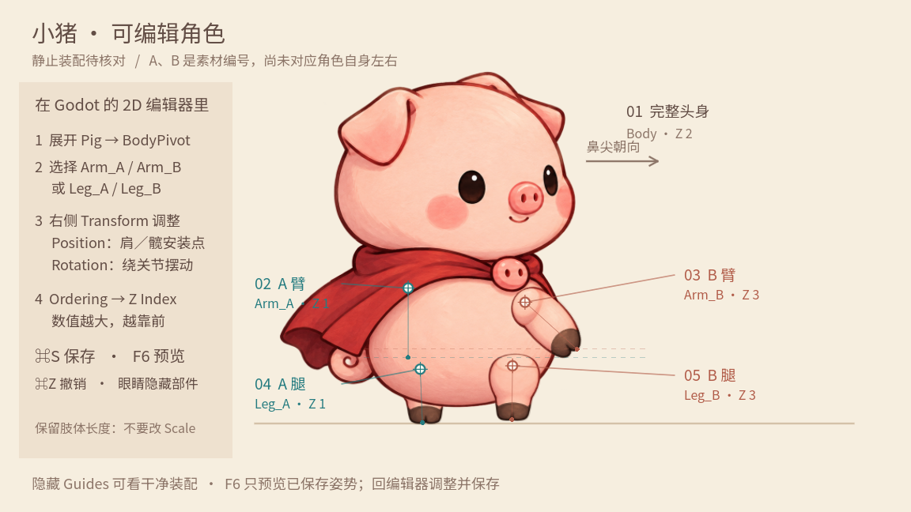

# 小猪角色可视化编辑

场景：[`editable_pig.tscn`](../scenes/animation_studies/editable_pig.tscn)。在 Godot 双击打开，顶部选择 **2D**。

这是可保存的静止装配工作台。五个图片部件、四个关节与覆盖片都已写入场景，调整不会被程序动画覆盖。初始位置取自上轮静止装配，仍待核对；A／B 只表示素材编号。

## 用你保存的装配试动作

**最新完整效果：** 润色后的橡子回忆也已读取这个装配。保存后打开 [`acorn_memory_final.tscn`](../scenes/cabbage_act2/acorn_memory_final.tscn) 按 **F6**，可以自动看完地面拾取、对白、戴项链及回到现实。正式桌面回忆同步使用；[效果说明](ACORN_MEMORY_FINAL_ZH.md)。以下独立试播的树根、16°前倾和未同高手臂说明仅适用于该旧试播。

2026-10-03 已接入独立 [`editable_pig_preview.tscn`](../scenes/animation_studies/editable_pig_preview.tscn)。先在编辑场景按 **⌘S**，再打开这个试播场景按 **F6**。每次停止后重新运行，会读取最新保存的部件位置、比例、角度和层级。空格暂停、R重播、S慢放，左右键逐帧。

你移动了两组四肢，并微调身体与 A 臂比例。部分改动在 `Artwork` 上，造成贴图的肩髋位置与关节 Marker 分离；试播会在运行副本中将旋转中心移到实际贴图肩髋处，静止外观保持一致，源场景不被改写。编辑界面的旧十字可能仍偏离贴图；后续装配调整建议选择关节节点。

新试播让 A 腿在前倾时向身体内收，由 B 腿支撑；使用目前靠前的 A 臂触碰并拿起橡子。A/B 仍不推断为角色自身左右。树根是可达性占位，双手保留你设置的静止角度，尚未恢复全程指尖同高约束。动作仍待用户复看，尚未接主线。

## 最短操作步骤

1. 左侧展开 **Pig → BodyPivot**，选中 `Arm_A`、`Arm_B`、`Leg_A` 或 `Leg_B`。
2. 在右侧 **Inspector → Transform** 修改：
   - **Position**：肩或髋的安装位置。适合先校准连接点。
   - **Rotation**：绕该关节转动。适合调整姿势；肢体长度不变。
3. 在 **Ordering → Z Index** 修改遮挡。数值越大越靠前：身体目前为 **2**，设为 **1** 的四肢在身体后面，设为 **3** 的四肢在身体前面。
4. **⌘S 保存**，**⌘Z 撤销**。按 **F6**（部分 Mac 用 **fn+F6**）预览当前场景；修改回到编辑器进行。

请选关节节点，不要选下面的 `Artwork` 来摆动四肢。保持关节的 Scale 为 `(1, 1)`；改变肢体长度不能解决连接问题。

画布看不到角色时，可选 `Body`，让鼠标位于中间 2D 画布后按 **F** 居中；左上角缩放数值用于调整视图。场景树里部件旁的眼睛可以隐藏被检查的部件。隐藏 `Guides` 可查看没有编号和参考线的角色，隐藏 `Backdrop` 可去掉工作台底色。

## 部件对应

| 图上编号 | 场景节点 | 源图区域标识 | 当前初始层级 |
| --- | --- | --- | --- |
| 01 完整头身 | `Pig/BodyPivot/Body` | `core` | 2 |
| 02 A 臂 | `Pig/BodyPivot/Arm_A` | `near_arm` | 1 |
| 03 B 臂 | `Pig/BodyPivot/Arm_B` | `far_arm` | 3 |
| 04 A 腿 | `Pig/BodyPivot/Leg_A` | `near_leg` | 1 |
| 05 B 腿 | `Pig/BodyPivot/Leg_B` | `far_leg` | 3 |

这些来源对应可由原图裁切区域核对；它们与猪自身左右的关系尚未确认。后续反馈可直接说“02 A 臂”或“05 B 腿”，避免混淆。

- `Pig`：移动、旋转、等比缩放整只角色。
- `BodyPivot`：完整身体及四肢共同前倾的中心。
- `Artwork`：原部件贴图，保留原始长度及裁切。
- `Tip`：部件上的固定蹄尖参考点。辅助虚线显示两手参考点的高度；旋转后不一定是轮廓最低点，不会自动调整双手同高。
- `Body/CollarCover`：与身体对齐的披风领口覆盖片；总层级为 4（身体 2 + 覆盖片 2），可用眼睛隐藏比较效果。
- `AnimationPlayer`：空白动画编辑入口。以后可新建动画，给四肢 Rotation 和整体 BodyPivot 的姿势加关键帧。当前没有动画或自动播放。

本场景使用标准层级和显式领口覆盖片，没有接入上轮试验中的动态肩／收腿遮挡 shader。肩帽等轮廓仍需复看；编辑结果由独立试播与完整橡子回忆读取，原 single_joint 试验样片保留。

## 验证记录 · 2026-10-03

已验证四肢位置、旋转和层级经保存／重载保留，运行多帧不覆盖手动姿势；绕肩旋转保持肩点，整体前倾带动子部件。实际 Godot GUI 中将 B 臂改为 -30° 并按 ⌘S，场景落盘值为 -0.5235988 弧度；随后 ⌘Z、⌘S 恢复初始角度。已检查图形预览和编辑器显示。测试只验证编辑能力，没有制作或验收新的行走、拾取、表情或音频。

Godot 的部件旋转、枢轴、层级及关键帧工作方式可参阅[官方剪纸动画说明](https://docs.godotengine.org/en/stable/tutorials/animation/cutout_animation.html)。本说明中的面板名称已在本机 Godot 4.7.2 核对。
