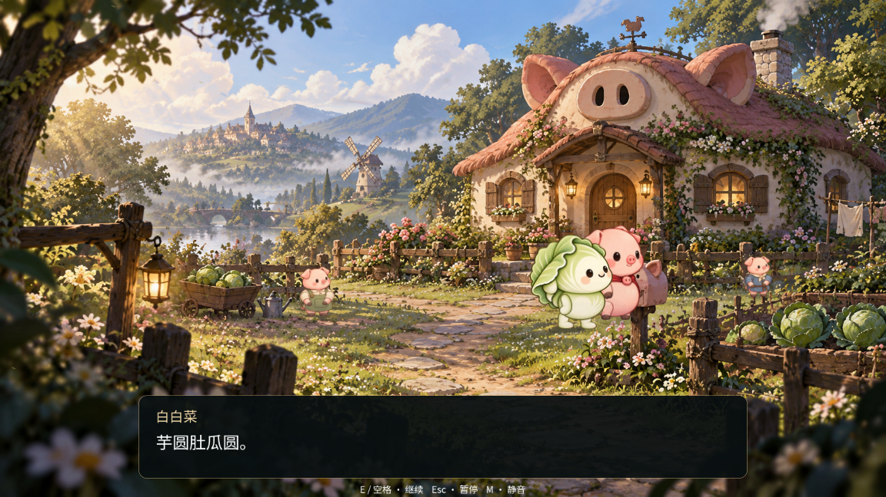

# 首次入镜与最终幕遮挡 · 2026-10-31

本轮承接镜头衔接调校，处理首次入镜卡顿与回家结尾红披风遮住白菜脸的问题。未改源美术、用户小猪装配、对白或正式存档。

## 实现

- 最终章创建后，在黑幕期间用小型离屏视口提交实际纹理、披风网格和材质，包含隐藏的白菜形态与回忆图；本轮提交21个绘制资源。场景路由等待绘制完成后才淡入。准备期间剧情和声音冻结，并跳过包含准备耗时的下一轮剧情步进。独立样片共用此流程；headless与固定帧离线导出跳过预热。
- 原来所有角色共用内部z层，猪的领口相对身体高2层，会覆盖另一个角色的脸。现在按脚底深度排列完整角色，各角色占独立层段，内部部件关系保持原样。场景特效仍在角色前、对白与回忆卡仍在世界前。

## 正常时间绘制测量

Apple M1、Godot4.7.2、OpenGL Compatibility、1152×648、60Hz，测试进程限制60FPS。每次独立启动一个图形进程，播放相同22秒六段剪选；无截图读回、无强制绘制。测量的是绘制提交间隔，不能等同于显示器呈现FPS或真人流畅度验收。

| 记录 | 首次显示最终章后600ms内最大间隔 | 全片P95 | 全片最大 |
| --- | ---: | ---: | ---: |
| [未预热对照](control2.json) | 63.947ms | 29.047ms | 63.955ms |
| [预热复测1](prepared3.json) | 33.403ms | 17.826ms | 35.093ms |
| [预热复测2](prepared4.json) | 24.858ms | 18.127ms | 38.056ms |

三次提交覆盖均有效。两次预热复测在最终章首次入镜处均未出现超过35ms的间隔；全片仍分别有35.093ms、38.056ms长间隔，发生在开场片段，因此不称为全游戏无卡顿。两次离屏预热耗时79.026ms、81.244ms，在黑幕期间完成，未消除这部分准备成本。

[开工复现](before1.json)也在同一首次入镜位置记录50.397ms，而该次切镜脚本CPU仅0.719ms，支持优先处理绘制资源首次使用；未通过GPU分析器证明具体驱动瓶颈。早期实验中预热曾约440ms，受缓存及环境影响，不能保证所有机器和冷启动都只需80ms。

[正式路由检查](routed_entry.json)从SceneRouter进入正式final_chapter并续到first_reunion，验证准备完成时遮罩仍完全不透明、剧情时钟保持0，之后声音与剧情恢复、遮罩释放。揭幕后约3秒提交覆盖有效，P95 29.381ms，最大35.809ms（在2.274秒）。此项验证交接正确，不冒称没有任何长帧。仅使用临时存档。

早期诊断的采样时序、轻微透明度容差与单例提前加载问题均已修正。一次有其他诊断窗口干扰的性能记录及中间图片留在`/tmp/piggy-entry-baseline/intermediate`，不纳入上表。

## 脸部遮挡

[修复前](face_before.png)在测试内恢复旧的跨角色混层；[修复后](face_after.png)使用正式层级。图形测试比较同一姿态中显示／隐藏呆呆猪时白菜眼睛与嘴部区域，原图画色略透明（例：alpha253/255），通道容差8/255。旧混层产生893个明显受遮挡采样点；回家对白、走远起中止、最后对白、离场共8个姿态，修复后均为0，见[数据](face_visibility.json)。这是指定区域与姿态的回归，不代表所有动作的真人美术验收。

## 回归与保护

17个不同headless脚本最终通过，覆盖镜头连续、切场、重逢／牵手／变身／巫师、路由、声音、暂停与重播、居民、回忆、男孩裁切、倍速，以及连续新游戏至Credits和结局续档。日志与[汇总](checks/results.json)位于`checks/`。旧缓存求解等价性检查原本用0.7运动权重，与上一轮有意修改的停步摆幅不同而失败；已将等价比较限定于仍应一致的满步幅，停步连续性由motion_transition_test覆盖，最大角度误差0.0000089rad。首次失败记录也保留，没有放宽角度阈值。既有系统证书与ObjectDB退出警告仍保留。

图形专项为`finale_face_visibility_test.gd`、`finale_entry_ready_test.gd`，测量工具为`scene_entry_profile.gd`；`--unprepared`仅启用测试派生脚本，不是正式游戏选项。

[五个保护文件](protected.json)包含正式存档及备份、用户editable_pig场景、原男孩图、原白菜图，SHA256与开工一致。仍使用现有男孩与手绘装配、既有配乐和合成音效；专用转身／下床／拾取动作、配音等原缺项不在本轮范围。上一轮22秒MP4保留历史版本，尚不含本轮披风遮挡修复。
