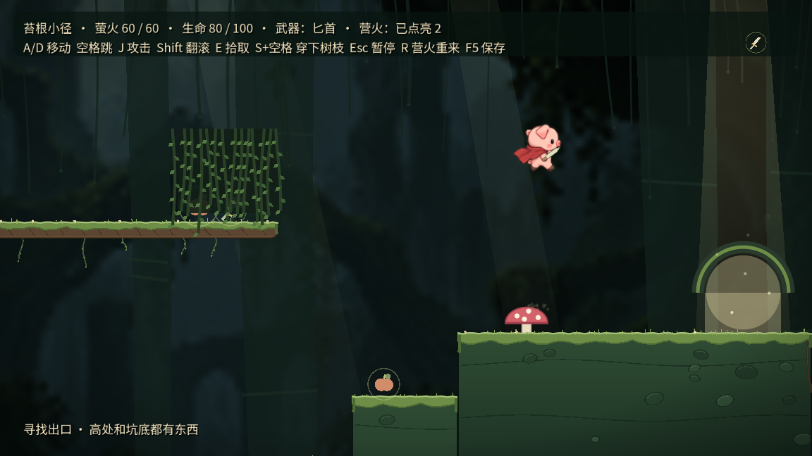

# 新游戏连续流程与 60 萤火验证 · 2026-10-30

## 已验证

- `full_story_flow_test.gd` 从主菜单新游戏开始，开场自然结束，连续调查三房间、经历森林巫师与拾树枝、发现山洞、真实碰撞受伤觉醒和挥击史莱姆、拾取礼物碎片、走到蘑菇屋、输入密码、收集四纸片、实际拖拽包装纸、点击求解桌面滑块、播放橡子回忆、调查红纤维、走完白菜道路、小猪坠洞、物理平台路线、重逢到 Credits。结局存档重新加载后仍在 Credits。
- 没有在途中重置进度、预填剧情完成标记、传送角色或修改生命。仅最后验证续档时 reset 后读取独立测试存档。
- 对白自动推进、近景自动收起，调查和部分出门使用正式处理函数并先验证实际靠近；不是全程 OS 鼠标键盘输入，更不是人类盲玩。平台使用物理帧按键与自动躲避反应。
- `all_fireflies_route_test.gd` 独立关 **60/60、2 秘密、0 死亡**；主线适配关同样 **60/60、2 秘密、0 死亡**，收集 ID 写盘后 reset/load 检查仍为 60，再经真实出口切入最终章。
- JSON 证据列出全部 60 个编号、关内位置、taken 状态与路线最近距离；未改变原有萤火位置、44 像素拾取半径、跳跃能力、敌人或关卡几何。

## 正常速度图形结果

Mac Apple M1 OpenGL 连续新游戏到 Credits 和结局续档通过（`full_story_graphical.log`，退出0）。主线全收集最终正常速度复跑也通过：60/60、2秘密、0死亡，关内计时89.3秒；60个ID写盘/重读及出口切入最终章通过，退出0。此关内计时不是完整新游戏的耗时，也不是人类速度记录。



截图已经目视复查，HUD显示60/60。逐编号数据见 `fireflies_story_graphical.json`。汇总见 `results.json`，其中失败尝试单独列为诊断记录。

## 全收集路线

1. 入口拿剑，先落到小台阶上；第一荆棘坑用短跳沿萤火弧线通过，长跳会飞过上方。
2. 击退史莱姆，跳上两层树枝，走到树枝两端收齐；落回蘑菇左侧，再弹上高崖。
3. 点亮第一营火，搭石板走上路；荆棘回廊额外小跳，过碎石板、升降台和树冠，两处缺口用较短跳跃，第二个缺口落地后回走至平台左缘，收取靠边的萤火。
4. 藤帘暗格拿锤，走到最后高台，停在出口蘑菇上方收齐竖直列。**主线不要继续走到最右出口**，先按 R 回第一营火。
5. 从摆渡坑落到下方，往左走到坑底起点，再向右清怪、跳取中间高处萤火，踩金色蘑菇返回。
6. 第二次经过升降台改走林下，点亮第二营火，走完下路后上最后台阶。收齐后才走到出口。

R 是游戏已有的营火重来操作，不扣死亡次数；这条证明使用 R 折返，不宣称是一条不重来的单向路线。普通玩家的难度、节奏和提示是否足够仍待人工试玩。

## 运行

在仓库根目录：

```sh
/Users/missdaidai/Godot.app/Contents/MacOS/Godot --headless --path . --fixed-fps 60 --log-file /tmp/full-flow.log --script res://tests/full_story_flow_test.gd
/Users/missdaidai/Godot.app/Contents/MacOS/Godot --headless --path . --fixed-fps 60 --log-file /tmp/all-flies.log --script res://tests/all_fireflies_route_test.gd
STORY_FIREFLIES=1 /Users/missdaidai/Godot.app/Contents/MacOS/Godot --headless --path . --fixed-fps 60 --log-file /tmp/story-flies.log --script res://tests/all_fireflies_route_test.gd
```

正常速度图形运行去掉 `--headless --fixed-fps 60`，使用 `--rendering-driver opengl3`。`--fixed-fps` 是加速确定步长的技术验证，不作为帧率或动态观感证据。所有存档使用脚本指定 `/tmp/piggy-*` 路径；不要同时运行两份同名测试。

## 排查记录与限制

编写回归时修正过测试自身的自定义类型过早编译、数字输入缺 unicode、死亡溶解尚未结束就检查碎片、跨切场访问已释放角色，以及 JSON 整数反序列化成浮点造成的严格类型比较假失败。主线全收集路线还需避免长跳落入出口蘑菇后直接弹到终点，已改为受控落点；这些未证明游戏本身存在卡死，未据此改动正式玩法。

正常速度全收集前两轮漏收了编号46（第47个）萤火，最近距离44.8003px，超出原44px拾取范围。固定步长下原路线可收取，正常速度落地稍远；路线新增落地后走回树冠平台左缘，未修改游戏判定。可复查失败日志 `attempt_graphical_missed_46.log`；最终结果以 `results.json` 中通过的记录为准。

headless 保留系统证书提示；退出有 ObjectDB 资源警告，未将其描述为全部消除。图形窗口被遮挡时部分平台截图被跳过，运行到结局不等于逐帧绘制覆盖、美术、音频或趣味性验收。无新增美术或音频。
