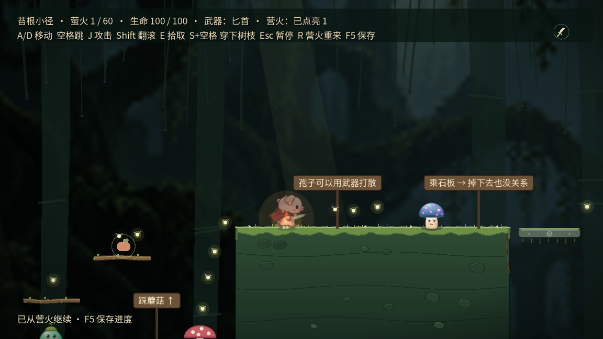
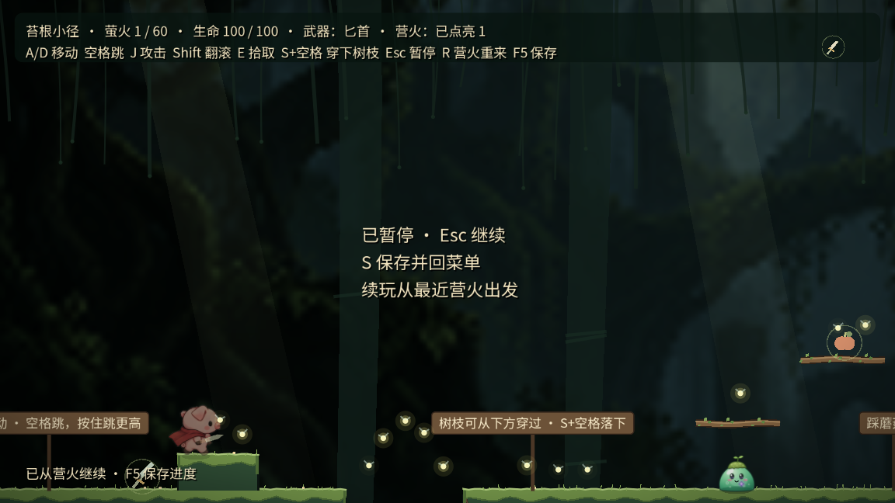
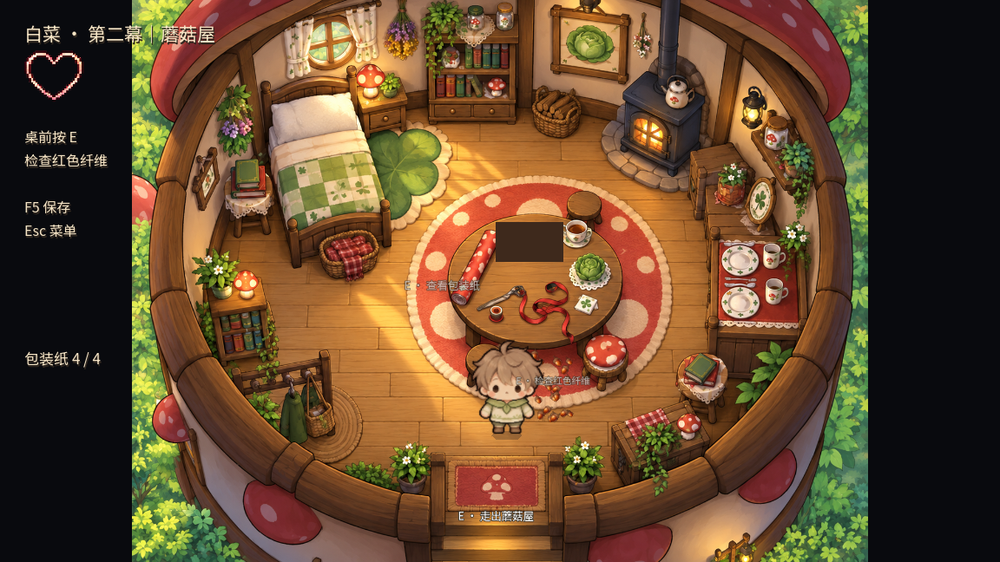
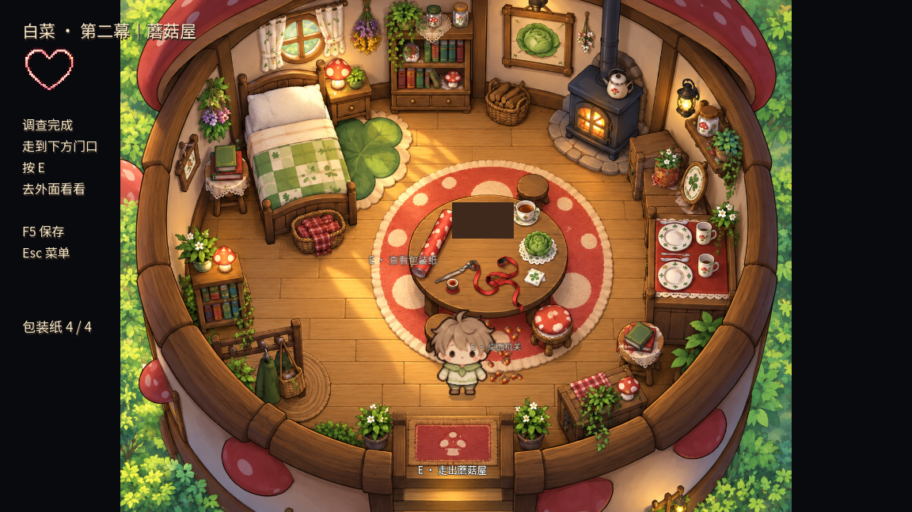

# 四项游戏性验证 · 2026-10-16

28个不同测试脚本最终通过，另有营火/蘑菇屋提示两项图形复验。逐项标记与原始日志见 [results.json](results.json)。日志是本轮最终通过记录，修复过程中的失败与原因记于当前handoff。

运行方式：在项目目录使用 Godot `--headless --path . --log-file /tmp/测试名.log --script res://tests/测试名.gd`；真实按键路线使用 `action_route_test.gd` 并省略 `--headless`。存档测试使用独立临时路径，图形测试也不覆盖玩家存档。

## 覆盖与限制

- 森林：保护壳反馈、40%阈值、翻滚/招架/跳跃、强化攻击、唯一碎片、重试与切换角色。
- 平台：物理按键双路线、武器/怪物/平台、营火与保存恢复；自动路线90.3秒关内计时、39/60萤火、2秘密、0死亡。自动翻滚反应不代表普通玩家难度。
- 探索：第一幕必需线索/门口可达、点击与进度门槛、包装纸收集/拖拽、密码锁、桌面滑块400次洗牌合法性与界面求解、回忆中途存档/重播、阶段提示。
- 主线：蘑菇屋/洞穴两种完成顺序、回归未完成调查、存档场景/字段校验、备份回退、碎片去重、结局和独立预览隔离。路线衔接使用状态夹具和加速推进，不宣称一轮从新游戏到Credits全程人工玩通。

所有逻辑结果不代替美术、动画、听感或趣味性验收。没有新音频或动画素材。Headless系统证书/退出资源警告仍存在；故意无效保存路径和坏JSON报错是负向测试。

## 实际窗口截图

