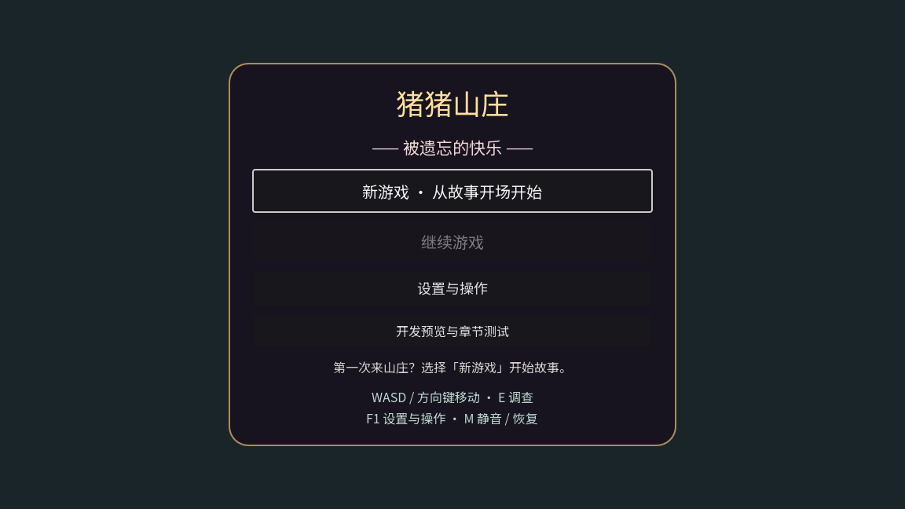
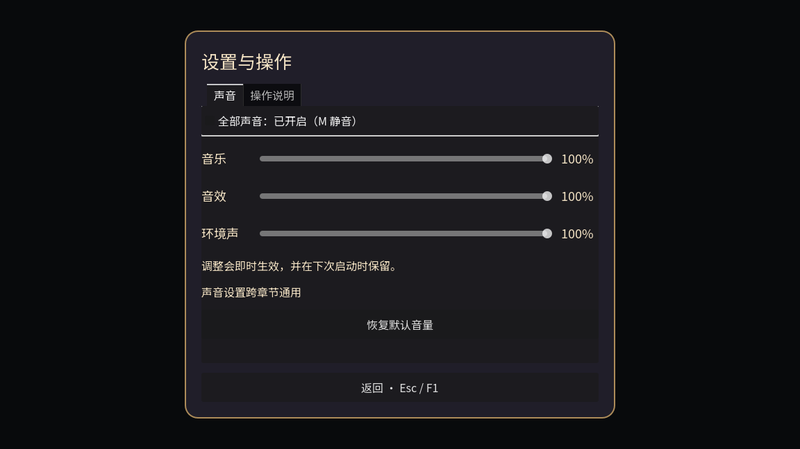

# 第 1、2 阶段验证证据

环境：本机 Godot 4.7.2 stable / Apple M1 / OpenGL。测试存档、偏好文件使用 `/tmp`，没有改玩家正式文件。

## 通过结果

- [20 项功能回归结果](results.json)：19 个相关专项 + 修改后固定步长完整主线，全部退出 0。日志见 `logs/`。最终设置专项包含真实 F5、暂停菜单保存失败原地保留与恢复可写路径后重试。
- [改动前正常速度完整主线](logs/baseline-full-flow.log)：新游戏到 Credits、结局续档，`FULL_STORY_OK`。
- [稳定画面补拍](logs/baseline-stable-states.log)：`AUDIT_STATES_OK`。
- [改动后图形 UI 回归](logs/settings-ui-graphical.log)：`SETTINGS_UI_OK`，三个真实窗口尺寸，含 Tab／方向键滑条、暂停嵌套、预览往返、写盘失败重试。
- [设置跨进程结果](restart_results.json)：[写入](logs/settings-restart-write.log)后退出，再由新进程[读取](logs/settings-restart-read.log)并检查三个音量和全局静音。
- [改动后场景 UI 补拍](logs/after-stable-states.log)：第一幕目标／近景／暂停／设置、森林小窗口 HUD、最终章暂停。

正常速度完整主线属于阶段 1 基线；修改后完整主线使用固定步长 headless，修改后真实窗口专项另列。自动对白与部分正式函数调用不等于人工盲玩；静态截图不证明连续动画流畅或音乐听感。全收集沿用同日上一专题，本轮没有重跑全部 60 萤火路线。

故意不可写路径的 ERROR 是预期负向用例，系统证书、IMK 和 ObjectDB/资源退出警告保留。[补测驱动诊断](diagnostics/input-delivery-failed.log)记录了仅向 Viewport 注入 F5、未更新物理轮询 Input 状态导致的断言；最终改用 Input.parse_input_event 和物理帧等待后通过，不记作正式保存逻辑 Bug。

## 尺寸说明

项目仍使用 1152×648 逻辑画布等比缩放；真实窗口分别为 800×600、1152×648、1440×900。视口导出的图分别为 800×450、1152×648、1440×810，不含外侧窗口留黑。当前检查可见控件无裁切，未实现任意长宽比的整场景重排；小窗口文本随比例缩小，可读性进一步打磨留后续阶段。

## 审核路线：18 步基线截图

以下截图均已打开查看。切场早期的密码锁、桌面、黑暗小径图未采用；稳定补拍来自同一实现的独立检查入口。

| 步骤 | 截图 | 观察与限制 |
| --- | --- | --- |
| 1 | [主菜单](before/00-menu.png) | 基线入口混层、第一幕旧名；阶段 2 已处理 |
| 2 | [城堡开场，稳定补拍](before/01-opening-stable.png) | 连续开场通过；阶段 2 统一 Esc 暂停 |
| 3 | [卧室调查](before/02-bedroom-investigation.png) | 物品、出口可识别；阶段 2 补持续目标 |
| 4 | [厨房调查](before/03-kitchen-investigation.png) | 原调查门槛保留；目标与操作分开 |
| 5 | [客厅离家](before/04-living-investigation.png) | 抱枕、出口和门槛可检查 |
| 6 | [森林苏醒](before/05-forest-wake-and-wizard.png) | 目标存在；完整拾取动作仍缺 |
| 7 | [发现山洞](before/06-find-cave.png) | 洞口明确；完整环境音仍缺 |
| 8 | [史莱姆战斗](before/07-real-slime-combat.png) | 预警和40%条件可见；理解成本待人工试玩 |
| 9 | [白菜外景](before/08-boy-exterior-route.png) | 方向可见；阶段 2 增加文字轮廓 |
| 10 | [密码锁，稳定预览](before/09-lock-stable.png) | 数字、删除、打开、返回可见；无提示是既定设定 |
| 11 | [蘑菇屋收集](before/10-collect-four-paper-scraps.png) | 阶段数量和桌面入口可见 |
| 12 | [包装纸，稳定预览](before/11-paper-stable.png) | 拖拽目标和吸附说明可见；全键盘完成未验证 |
| 13 | [桌面机关，稳定预览](before/12-table-stable.png) | 参考图、撤回与方向键说明可见 |
| 14 | [橡子回忆，稳定预览](before/12b-acorn-memory.png) | 原回忆保留；动作/听感仍待验收 |
| 15 | [白菜道路](before/13-boy-final-forest-path.png) | 前进与暂停说明可见 |
| 16 | [黑暗小径，稳定补拍](before/14-dark-path-stable.png) | 照明与移动说明可见；保留既定暗度 |
| 17 | [平台关](before/15-physical-platform-route.png) | 营火/移动提示存在；本次不是全收集 |
| 18 | [小猪道路](before/16-reunion-through-credits.png)、[重逢补拍](before/17-reunion-dialogue.png)、[Credits补拍](before/18-credits.png) | 连续通关另有日志；补拍跳至指定段落，字幕大小/观感留后续 |

## 修改后界面

主菜单：正式开始和继续优先，开发预览收进单独页面。



声音设置：三个音量、全局静音、恢复默认和返回；写盘结果独立显示。



| 截图 | 本次观察 |
| --- | --- |
| [800×600 菜单](after/menu-800x600.png)、[1440×900 菜单](after/menu-1440x900.png) | 保持等比缩放，没有控件裁切 |
| [小窗口设置](after/settings-800x600.png) | 三个滑条和返回可操作，字号随比例缩小 |
| [小窗口说明](after/controls-800x600.png)、[标准说明](after/controls-1152x648.png)、[大窗口说明](after/controls-1440x900.png) | 帮助文字和返回在可见区域内 |
| [开发预览分组](after/preview-menu.png) | 章节名称和测试隔离说明可见 |
| [持续目标](after/chapter1-objective.png) | 当前目标、靠近交互和基础按键分开 |
| [调查大图](after/chapter1-closeup.png) | 原画保留，Esc 收起，不穿透打开底层菜单 |
| [第一幕暂停](after/chapter1-pause.png)、[暂停中设置](after/chapter1-settings.png) | 关闭设置后仍回到原暂停菜单 |
| [森林小窗口 HUD](after/forest-hud-800.png) | 目标、生命和按键行未裁切 |
| [最终章暂停](after/finale-pause.png) | 设置入口已接入，自动对白选项保留 |
| [保存失败](after/save-failure.png) | 实际 F5 与暂停保存失败后仍在原卧室，随后恢复路径重试成功 |
| [设置写盘失败](after/settings-failure.png) | 明确当前调整生效但未保存，提供重试按钮 |

## 复现

在仓库目录运行；若 Godot 在其他路径，使用 `--godot` 指定可执行文件：

```bash
python3 tools/run_phase12_checks.py
python3 tools/run_phase12_checks.py full_story_flow_test --output /tmp/piggy-phase12-flow-repeat
```

图形专项需要本机窗口权限，同一个测试不要并发运行两份：

```bash
PIGGY_SETTINGS_PATH=/tmp/piggy-ui-preferences.cfg PIGGY_SAVE_PATH=/tmp/piggy-ui-save.json /Users/missdaidai/Godot.app/Contents/MacOS/Godot --path . --rendering-driver opengl3 --audio-driver Dummy --log-file /tmp/piggy-ui.log --script res://tests/settings_ui_test.gd
```

跨进程设置检查：

```bash
PIGGY_SETTINGS_PATH=/tmp/piggy-restart.cfg PIGGY_RESTART_WRITE=1 /Users/missdaidai/Godot.app/Contents/MacOS/Godot --headless --path . --log-file /tmp/piggy-write.log --script res://tests/settings_restart_test.gd
PIGGY_SETTINGS_PATH=/tmp/piggy-restart.cfg PIGGY_RESTART_WRITE=0 /Users/missdaidai/Godot.app/Contents/MacOS/Godot --headless --path . --log-file /tmp/piggy-read.log --script res://tests/settings_restart_test.gd
```

截图驱动保存在 `capture_scripts/`，输出为脚本中注明的 `/tmp` 目录。重新运行 baseline 驱动只会采集当前代码画面，不能复原旧基线；旧基线以本目录截图/日志为准。验证目录含 `.gdignore`，避免文档截图和历史驱动导入游戏资源。
