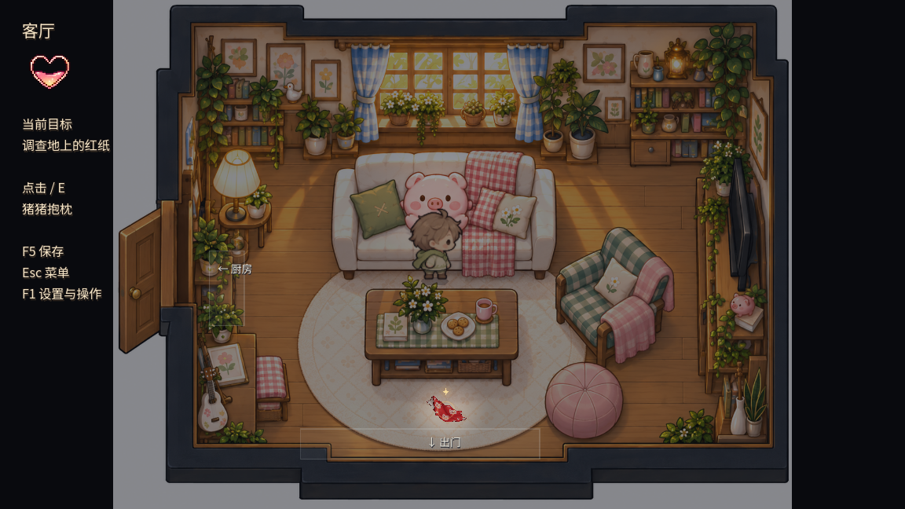

# 猪猪抱枕触发范围 · 2026-10-31

用户反馈抱枕难触发。原画中的抱枕中心约(690,435)，旧地面判定点却在沙发左侧(410,570)、半径155；站在抱枕正前方(690,600)时相距约282，反而不能调查。

已将热点对齐沙发前方(690,600)，可达区覆盖沙发前过道及左侧靠近区域`Rect2(350,535,595,155)`。点击和E键共用此判定，不要求朝向；移除误导为单点站位的地面小圈，保留抱枕本身的微光。家具碰撞、移动速度、素材、对白、回忆与红纸条件未改。

4个不同headless脚本最终通过：抱枕专项、第一幕导航、第一幕流程和UI。图形窗口专项正常时间通过6处实际走路抵达、24次朝向检查、12次键盘／鼠标打开近景；从茶几下方点击抱枕被拒绝，红纸仍优先提示，门口／收纳篮附近不选中抱枕。重复调查不增加超过第三阶段的心形进度，仍须调查红纸才能出门。见[结果](checks/results.json)、[实际站位](approaches.json)与[图形日志](checks/graphical.log)。未重跑全游戏，也不等同于用户手感验收。

首轮测试误把视口鼠标坐标交给系统输入入口，导致点击注入失败；改用视口鼠标事件后headless与图形窗口均通过。失败日志保留，键盘仍用Input.parse_input_event并等待物理帧，没有直接调用interact冒充输入测试。

[点击后近景](pillow_closeup.png)。截图处是重复调查，故左侧任务目标已切至红纸。

背景、抱枕源图和用户小猪装配三项哈希保持一致。期间另有用户从编辑器启动的正式游戏进程，正式存档与备份从原记录更新到山洞／山庄场景；本轮所有测试使用独立PIGGY_SAVE_PATH，测试不写正式存档，且没有将用户新进度恢复为旧哈希。具体保护记录见[protected.json](protected.json)。
